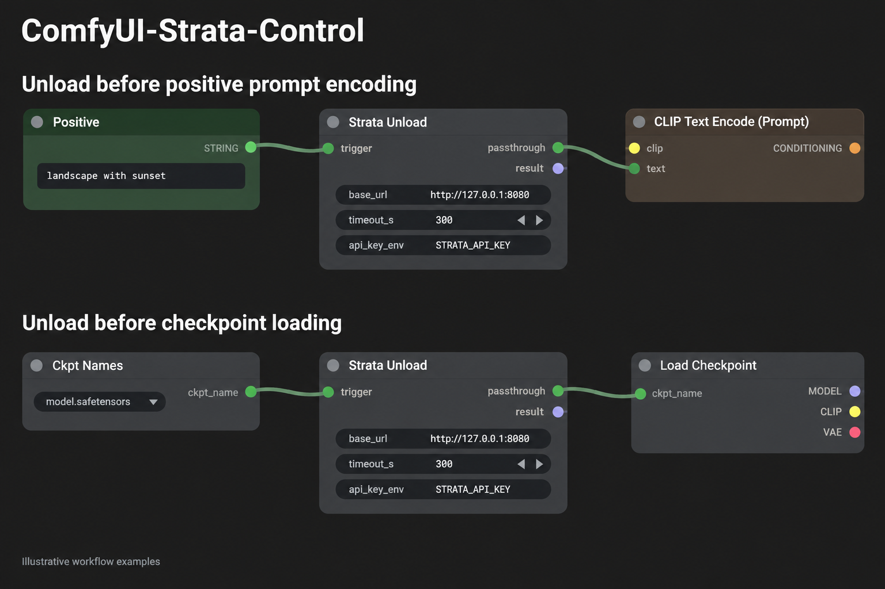
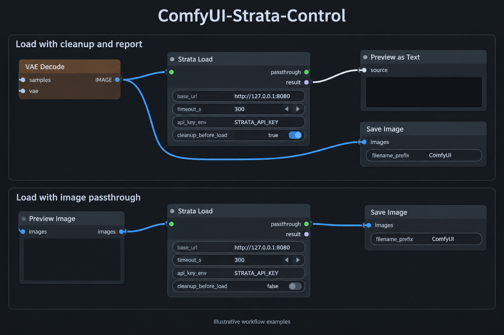

# ComfyUI-Strata-Control

A lightweight ComfyUI custom node pack for
[Strata](https://github.com/Niko1221/Strata), designed to unload Strata
before generation and reload it afterward.

It provides a manual control panel, dedicated Load / Unload nodes,
and a standalone memory cleanup node, with memory usage reporting.

Strata control operations require an already-running Strata HTTP server.
The standalone memory cleanup node does not require a Strata connection.

## Features

- Manual Status, Load, and Unload buttons.
- Dedicated workflow nodes for unloading Strata before generation and loading it afterward.
- A standalone ComfyUI memory cleanup node that does not call the Strata API.
- Optional passthrough connections for establishing execution dependencies.
- Cache-disabled Load, Unload, and Memory Cleanup nodes.
- Optional pre-load memory cleanup, disabled by default.
- Sequential memory cleanup and GPU synchronization before sending the Load request.
- RAM and supported GPU memory measurements in cleanup reports.
- Configurable Strata server URL and request timeout.
- Optional Bearer authentication through a server-side environment variable.
- Server-side HTTP requests to avoid browser CORS restrictions.

## Included Nodes

All nodes are listed under the `Strata Control` category.

| Node | Description |
|---|---|
| Strata Control - Panel | Provides manual Status, Load, and Unload buttons. |
| Strata Control - Unload | Sends a Strata model-unloading request when executed by the workflow. |
| Strata Control - Load | Optionally cleans up ComfyUI memory, then sends a Strata model-loading request. |
| Strata Control - Memory Cleanup | Performs local ComfyUI memory cleanup without calling the Strata API. |

The Memory Cleanup node attempts both model unloading and memory cleanup.
It is not limited to clearing unused VRAM caches.

## Requirements

- A working ComfyUI installation.
- Python 3.9 or newer.
- ComfyUI's existing `aiohttp`, `psutil`, and PyTorch dependencies.
- An already-running Strata server for Panel, Load, and Unload operations.
- Network access from the ComfyUI server to the Strata server.

No additional pip installation should be necessary in a standard compatible ComfyUI environment.

## Installation

### Using Git

Run the following command from your ComfyUI root directory:

```bash
git clone https://github.com/andrewcell/ComfyUI-Strata-Control.git custom_nodes/ComfyUI-Strata-Control
```

Restart ComfyUI, then hard-refresh your browser to reload frontend extensions.

### Manual Installation

1. Download and extract the repository.
2. Place the extracted folder inside `ComfyUI/custom_nodes`.
3. Ensure the folder is named `ComfyUI-Strata-Control`.
4. Restart ComfyUI.
5. Hard-refresh your browser.

The directory structure should look like this:

```text
ComfyUI/
└── custom_nodes/
    └── ComfyUI-Strata-Control/
        ├── __init__.py
        ├── README.md
        ├── images/
        │   ├── unload.png
        │   └── load.png
        └── web/
            └── control_panel.js
```

Search for `Strata Control` in the node menu.

## Configuration

### Strata Connection Settings

Panel, Load, and Unload provide the following settings:

| Setting | Default | Description |
|---|---|---|
| `base_url` | `http://127.0.0.1:8080` | Root URL of the Strata server. Do not append `/v1`. |
| `timeout_s` | `300` | HTTP request timeout in seconds. Allowed range: 1–1800. |
| `api_key_env` | `STRATA_API_KEY` | Name of the ComfyUI server environment variable containing the Bearer token. |

Load also provides:

| Setting | Default | Description |
|---|---|---|
| `cleanup_before_load` | `false` | Performs local ComfyUI memory cleanup and GPU synchronization before sending the Load request. |

`timeout_s` applies to the HTTP request. It does not limit the duration of local memory cleanup.

### Standalone Cleanup Settings

Memory Cleanup does not require a server URL or API key.

| Setting | Default | Description |
|---|---|---|
| `enabled` | `true` | Enables local memory cleanup. When disabled, the node passes through its input and reports that cleanup was skipped. |

### Server Address

Requests originate from the ComfyUI server, not from your browser.

- Use `127.0.0.1` when Strata and ComfyUI run on the same host and network namespace.
- Use the Strata host's address when it runs on another machine.
- If ComfyUI runs inside a container, `127.0.0.1` refers to that container.

Use the server root URL:

```text
http://127.0.0.1:8080
```

Do not use:

```text
http://127.0.0.1:8080/v1
```

The current implementation rejects URLs containing embedded credentials, query strings, fragments, or non-root paths.

### Authentication

If your Strata server requires Bearer authentication, set an environment variable before starting ComfyUI.

Linux:

```bash
export STRATA_API_KEY="your-api-key"
python main.py
```

Windows PowerShell:

```powershell
$env:STRATA_API_KEY = "your-api-key"
python main.py
```

Leave `api_key_env` set to `STRATA_API_KEY`, or change it to another environment variable name.

The extension reads the variable and sends:

```http
Authorization: Bearer <value>
```

If the variable is missing or empty, no Authorization header is sent.

**Important:** The `api_key_env` field expects an environment variable name, not the actual API key.

Restart ComfyUI after changing the environment used to launch it.

## Strata Control - Panel

Add a `Strata Control - Panel` node and configure its server address.

The panel provides three buttons:

| Button | Request | Purpose |
|---|---|---|
| Status | `GET /health` | Queries the server's health response. |
| Load | `POST /load` | Requests model loading. |
| Unload | `POST /unload` | Requests model unloading. |

Load and Unload display a confirmation dialog before sending the request.

The `last_result` field displays the response or an error message.
Successful responses are also logged to the browser console.

### Manual Request Behavior

Panel buttons send requests immediately.
They do not enter the ComfyUI execution queue.

Use them only when it is safe to change Strata's model state.
A manual request may conflict with an active Strata request or another workflow.

The panel's Load button does not perform pre-load memory cleanup.
To use that feature, execute `Strata Control - Load` with
`cleanup_before_load` enabled.

Executing the Panel as part of a graph does not automatically load or unload Strata.
Its graph function only passes through its optional input and returns an informational message.

The panel's `last_result` display is separate from its graph `result` output.
Clicking a button updates the display, not the graph output.

## Strata Control - Load / Unload

These nodes send HTTP requests when ComfyUI executes them as part of a workflow.

### Inputs

| Input | Available On | Description |
|---|---|---|
| `base_url` | Load / Unload | Strata server root URL. |
| `timeout_s` | Load / Unload | HTTP request timeout. |
| `api_key_env` | Load / Unload | Environment variable name for optional authentication. |
| `cleanup_before_load` | Load only | Enables local memory cleanup before the Load request. Defaults to `false`. |
| `trigger` | Load / Unload | Optional dependency input. Its value is returned through `passthrough`. |

### Outputs

| Output | Description |
|---|---|
| `passthrough` | Returns the value received by `trigger` after the operation succeeds. |
| `result` | JSON-formatted operation information as a string. Load includes memory measurements and cleanup status. |

If `trigger` is not connected, `passthrough` returns `None`.

Both nodes are registered as output nodes, so they can execute without a downstream connection.

Their execution cache is disabled.
Each time the node executes in a queued workflow, it sends a new HTTP request.

### Load Does Not Start the Server

Load sends a model-loading request to an already-running Strata HTTP server.

It does not launch Strata or restart a stopped server process.

Likewise, Unload requests model unloading.
It does not terminate the Strata HTTP server process.

## Strata Control - Memory Cleanup

This node performs local ComfyUI memory cleanup without sending any Strata API request.

Use it when you want to:

- Run cleanup independently.
- Inspect cleanup results through Preview as Text.
- Separate cleanup and Strata loading into explicit workflow stages.

### Use Memory Cleanup Instead of Load

If you only want to clean up ComfyUI memory without loading Strata,
replace the Load node with Memory Cleanup in the same workflow position.

For example:

```text
Final IMAGE
    │
    ▼
Strata Control - Memory Cleanup
    │ passthrough
    ▼
Save Image
```

The `trigger` and `passthrough` connections serve the same purpose:
the downstream node waits until cleanup succeeds.

Unlike Load, Memory Cleanup does not contact Strata or load its model.
Its `result` output contains only the cleanup report.

The image passed through the node remains referenced and is not deleted
by cleanup. If cleanup fails, the downstream Save Image node does not execute.

### Inputs

| Input | Description |
|---|---|
| `enabled` | Enables cleanup. Defaults to `true`. |
| `trigger` | Optional dependency input. Its value is returned through `passthrough`. |

### Outputs

| Output | Description |
|---|---|
| `passthrough` | Returns the value received by `trigger` after cleanup succeeds, or immediately when disabled. |
| `result` | JSON-formatted cleanup report, or a skipped status when disabled. |

If `trigger` is not connected, `passthrough` returns `None`.

The node is registered as an output node and has its execution cache disabled.

### Cleanup Only

```text
Strata Control - Memory Cleanup
    │ result
    ▼
Preview as Text
```

### Separate Cleanup and Load

```text
Final IMAGE
    │
    ▼
Strata Control - Memory Cleanup
    │ passthrough
    ▼
Strata Control - Load
    │ passthrough
    ▼
Save Image
```

Set `cleanup_before_load` to `false` on Load to avoid running cleanup twice.

The image passed through these nodes remains referenced.
Cleanup does not delete it.

In this arrangement, Save Image waits for both cleanup and loading to succeed.

## Memory Cleanup Behavior

The standalone Memory Cleanup node and Load's optional pre-load cleanup
use the same cleanup function.

### Cleanup Sequence

When cleanup is enabled, the updated function:

1. Waits for pending GPU work to complete.
2. Records memory usage before cleanup.
3. Runs garbage collection and releases unused runtime/device caches, including CUDA IPC collection where available.
4. Calls ComfyUI's model-unloading function.
5. Runs garbage collection again after model unloading.
6. Calls ComfyUI's device-cache cleanup function.
7. Waits for pending GPU work to complete.
8. If requested, performs a best-effort OS-specific memory trim.
9. Records memory usage after cleanup and returns a report.

The standalone Memory Cleanup node enables OS-specific trimming through
`cleanup_comfyui_memory(trim_os_memory=True)`.
The helper's default is `trim_os_memory=False`; other callers, including
Load's optional pre-load cleanup, must explicitly pass `True` to enable trimming.
This internal argument is not a new node widget.

When used inside Load, the Strata Load request is sent only after the
synchronous cleanup function returns successfully.

OS trimming errors are reported in `os_memory_trim` rather than raised by
the trim helper. A top-level `cleanup_completed` status does not by itself
mean OS trimming succeeded; inspect `os_memory_trim.status`.
Other cleanup failures can still raise an error and prevent the Load request.

### OS-Specific Memory Trimming

| Platform | Method | Behavior |
|---|---|---|
| Windows | `EmptyWorkingSet()` | Requests removal of as many pages as possible from the current process's working set. Does not release private commit. |
| Linux | `malloc_trim(0)`, when available | Attempts to return unused allocator-managed heap memory to the operating system. Not equivalent to Windows working-set trimming. |
| Other platforms / missing API | Skipped | Reports a skipped status without calling unsupported APIs. |

Windows API loading occurs only inside the Windows branch. Linux does not
attempt to load Windows DLLs. On Linux, a missing `malloc_trim` symbol is
reported as skipped. Its return value of zero means no memory was returned,
not an API failure.

Working-set trimming is a one-time request, not a permanent RSS limit.
Python execution, report generation, server activity, and later workflow
operations can bring pages back into the working set. A nonzero or growing
RSS after trimming does not by itself indicate failure or a memory leak.
Re-accessing trimmed pages can add page-fault overhead, so trimming is most
useful when handing memory over to another workload rather than repeatedly
trying to keep RSS near zero.

Linux trimming only affects free memory managed by the allocator exposing
`malloc_trim`. It does not promise to release all library caches, live tensors,
pinned allocations, or memory managed by alternative allocators.

### Cleanup Scope

The cleanup process attempts to release memory through:

- ComfyUI model unloading.
- Python garbage collection.
- ComfyUI's GPU cache cleanup function.
- Explicit release of unused CUDA allocator caches where available.

It does not forcibly delete:

- Live tensors still referenced by the workflow.
- Data retained by ComfyUI's execution cache.
- Objects retained by custom-node caches.
- The value connected to `trigger`.
- Memory used by other processes.
- GPU driver or runtime allocations.

Cleanup completion does not mean that all RAM or VRAM is empty.

No minimum free-memory threshold is enforced.
Other processes may also allocate memory after cleanup.

### Windows Commit Size

A reduction in physical memory usage does not necessarily mean that
the ComfyUI process's Commit size will decrease by the same amount.

Live references, caches, and retained allocations may keep private committed memory high.

Cleanup does not guarantee that Windows Commit size returns to its startup value.

### Device Support

The cleanup process uses ComfyUI's memory-management functions.

Explicit GPU synchronization is implemented for CUDA, XPU, and MPS
where those backends are available.

Detailed GPU memory measurements are currently implemented only for
devices exposed through `torch.cuda`.

For other backends, the report includes RAM measurements and a note
that detailed GPU metrics are unavailable.

## Memory Reports

### Standalone Cleanup Report

Memory Cleanup returns the cleanup report directly through `result`.

| Field | Description |
|---|---|
| `enabled` | Whether cleanup was enabled. |
| `status` | `skipped` or `cleanup_completed`. |
| `method` | Identifier of the primary cleanup implementation. |
| `elapsed_seconds` | Cleanup duration, when enabled. |
| `before` | Memory measurements before cleanup. |
| `after` | Memory measurements after cleanup. |
| `delta` | Differences between the cleanup measurements. |
| `scope` | Description of the cleanup scope. |
| `os_memory_trim` | OS-specific trim result when included by the updated implementation. Inspect its own status. |

When disabled, the node returns only the enabled state and skipped status.

### Load Report

Load returns a combined cleanup and loading report.

| Field | Description |
|---|---|
| `action` | Operation name: `load`. |
| `status` | `load_request_succeeded` when the request passes the implemented response checks. |
| `cleanup` | Cleanup report, or a skipped status when cleanup is disabled. |
| `load.elapsed_seconds` | Duration of the Load request. |
| `load.before` | Memory measurements immediately before the Load request. |
| `load.after` | Memory measurements after the Load response. |
| `load.api` | Strata API response information. |

Load measurements are recorded even when pre-load cleanup is disabled.

### RAM Measurements

| Field | Description |
|---|---|
| `system_total_bytes` | Total system RAM. |
| `system_available_bytes` | System-wide available RAM. |
| `comfyui_rss_bytes` | Resident memory of the ComfyUI process. |

The updated RAM snapshot also includes:

| Field | Description |
|---|---|
| `comfyui_private_commit_bytes` | Private committed memory of the ComfyUI process on Windows; `null` on other platforms. |

### GPU Measurements

For each supported GPU:

| Field | Description |
|---|---|
| `device_total_bytes` | Total device memory reported by the runtime. |
| `device_free_bytes` | Available device memory. |
| `device_used_bytes` | Total device memory minus available device memory. |
| `torch_allocated_bytes` | Memory allocated through the ComfyUI process's PyTorch allocator. |
| `torch_reserved_bytes` | Memory reserved by the ComfyUI process's PyTorch allocator. |

### Interpreting Deltas

All memory values are recorded in bytes.

For cleanup deltas:

| Field | Meaning of a Positive Value |
|---|---|
| `comfyui_rss_released_bytes` | ComfyUI's measured resident memory decreased. |
| `system_available_increase_bytes` | System-wide available RAM increased. |
| `device_free_increase_bytes` | Available GPU memory increased. |
| `torch_allocated_released_bytes` | PyTorch allocated memory decreased. |
| `torch_reserved_released_bytes` | PyTorch reserved memory decreased. |

`comfyui_private_commit_released_bytes` records the decrease in Windows
private committed memory. It is `null` when the measurement is unavailable.

In the updated cleanup implementation, decrease/increase deltas are clamped
to zero with `max(0, ...)`. A zero can therefore mean no change or a change
in the opposite direction; inspect `before` and `after` for the actual values.
RSS decrease is not necessarily equal to system-wide available RAM increase.
Neither should be described as private-commit release.

### OS Trim Report

Example on Windows:

```json
"os_memory_trim": {
  "status": "completed",
  "method": "windows_empty_working_set"
}
```

On Linux, the method is `linux_malloc_trim` and a completed call includes
`released_any`: `true` if the allocator reports returning memory, otherwise
`false`. Disabled, unsupported, and unavailable cases use `status: "skipped"`;
caught failures use `status: "error"` with an error message.

### Optional Pinned-Memory Diagnostics

Development builds may include `pinned_memory` snapshots. These are not
required for cleanup. If the report says `inconsistent_stats`, do not treat
its values as a reliable measurement of pinned-cache size, and do not turn
an invalid negative cache estimate into a claim of zero cache.

The allocation-based `pinned_memory_diagnostic` test should be removed from
normal cleanup reports after debugging because it performs an additional
16 MiB pinned allocation. These diagnostics do not establish the owner of
all retained private commit.

System-wide RAM and device-wide GPU measurements can be affected by other processes.
They do not isolate memory changes caused solely by this node.

The ComfyUI process's PyTorch measurements do not include allocations owned by a separate Strata process.

## Workflow Examples

### Unload Workflows



Examples of unloading Strata before:

- Positive prompt encoding.
- Checkpoint loading.

Connect the upstream value to `trigger`, then connect `passthrough`
to the downstream node to establish an execution dependency.

Gating the positive prompt encoder does not delay independent
model-loader branches.
Gate each relevant loader branch separately.

### Load Workflows



Examples of loading Strata with:

- Pre-load memory cleanup enabled and `result` connected to Preview as Text.
- Image passthrough connected to Save Image, with cleanup disabled.

`cleanup_before_load` defaults to `false`.
When enabled, local cleanup and GPU synchronization finish before the Load request is sent.

The `result` output includes cleanup status, memory measurements,
and the Load API response.

In the passthrough example, Save Image waits for the Load request to succeed.
A cleanup or Load failure prevents that downstream save operation.

Illustrations may show earlier node titles without the `Strata Control -` prefix.

## Execution Ordering

Placing a node on the canvas does not establish its order relative to independent graph branches.

Use `trigger` and `passthrough` to create an explicit dependency.

### Unload Before Text Encoding

```text
Prompt STRING
    │
    ▼
Strata Control - Unload.trigger
    │
    └── passthrough
            │
            ▼
    CLIP Text Encode.text
```

The text encoder waits for the unload request to succeed.

This does not delay independent checkpoint, UNet, CLIP, or VAE loader branches.

### Unload Before Model Loading

Where supported, convert a model loader's filename widget into an input
and route that value through Unload.

```text
Checkpoint name STRING
    │
    ▼
Strata Control - Unload.trigger
    │
    └── passthrough
            │
            ▼
    Load Checkpoint.ckpt_name
```

Keep the following limitations in mind:

- The loader must support converting the relevant widget to an input.
- The loader must accept the connection's type.
- The passthrough uses a wildcard conven