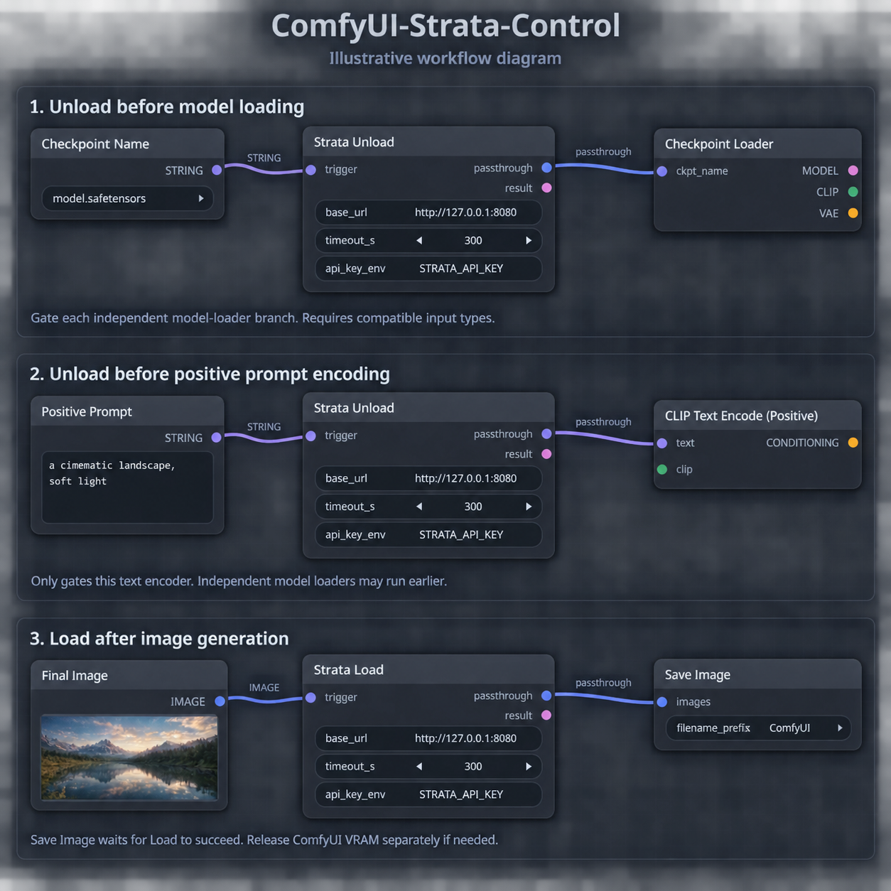

# ComfyUI-Strata-Control

A lightweight ComfyUI custom node pack for controlling an already-running Strata HTTP server.

It provides a manual control panel and dedicated Load / Unload nodes for workflow integration.

## Features

- Manual Status, Load, and Unload buttons.
- Dedicated workflow nodes for loading and unloading Strata models.
- Optional passthrough connections for establishing execution dependencies.
- Cache-disabled Load and Unload nodes.
- Configurable server URL and request timeout.
- Optional Bearer authentication through a server-side environment variable.
- Server-side HTTP requests to avoid browser CORS restrictions.

## Included Nodes

| Node | Description |
|---|---|
| Strata Control Panel | Provides manual Status, Load, and Unload buttons. |
| Strata Unload | Sends an unload request when executed by the workflow. |
| Strata Load | Sends a load request when executed by the workflow. |

## Requirements

- A working ComfyUI installation.
- Python 3.9 or newer.
- ComfyUI's existing `aiohttp` dependency.
- An already-running Strata server exposing the supported HTTP endpoints.
- Network access from the ComfyUI server to the Strata server.

No additional pip installation is required in a standard compatible ComfyUI environment.

## Installation

### Using Git

Run the following command from your ComfyUI directory:

```bash
git clone [https://github.com/andrewcell/ComfyUI-Strata-Control.git](https://github.com/andrewcell/ComfyUI-Strata-Control.git) custom_nodes/ComfyUI-Strata-Control
```

Restart ComfyUI, then hard-refresh your browser to reload frontend extensions.

### Manual Installation

1. Download and extract the repository.
2. Place the extracted folder inside `ComfyUI/custom_nodes`.
3. Ensure the folder is named `ComfyUI-Strata-Control`.
4. Restart ComfyUI.
5. Hard-refresh your browser.

The directory structure should look like this:

```text
ComfyUI/
└── custom_nodes/
    └── ComfyUI-Strata-Control/
        ├── __init__.py
        ├── README.md
        └── web/
            └── control_panel.js
```

Search for `Strata` in the node menu to add the nodes.

The current node category is `Strata Simple`.

## Configuration

All three nodes provide the following settings:

| Setting | Default | Description |
|---|---|---|
| `base_url` | `http://127.0.0.1:8080` | Root URL of the Strata server. Do not append `/v1`. |
| `timeout_s` | `300` | HTTP request timeout in seconds. Allowed range: 1–1800. |
| `api_key_env` | `STRATA_API_KEY` | Name of the ComfyUI server environment variable containing the Bearer token. |

### Server Address

Requests originate from the ComfyUI server, not from your browser.

- Use `127.0.0.1` when Strata and ComfyUI run on the same host and network namespace.
- Use the Strata host's address when it runs on another machine.
- If ComfyUI runs inside a container, `127.0.0.1` refers to that container.

Use the server root URL:

```text
http://127.0.0.1:8080
```

Do not use:

```text
http://127.0.0.1:8080/v1
```

The current implementation rejects URLs containing embedded credentials, query strings, fragments, or non-root paths.

### Authentication

If your Strata server requires Bearer authentication, set an environment variable before starting ComfyUI.

Linux:

```bash
export STRATA_API_KEY="your-api-key"
python main.py
```

Windows PowerShell:

```powershell
$env:STRATA_API_KEY = "your-api-key"
python main.py
```

Leave `api_key_env` set to `STRATA_API_KEY`, or change it to another environment variable name.

The extension reads the variable and sends:

```http
Authorization: Bearer <value>
```

If the variable is missing or empty, no Authorization header is sent.

**Important:** The `api_key_env` field expects an environment variable name, not the actual API key.

Restart ComfyUI after changing the environment used to launch it.

## Strata Control Panel

Add a `Strata Control Panel` node and configure its server address.

The panel provides three buttons:

| Button | Request | Purpose |
|---|---|---|
| Status | `GET /health` | Queries the server's health response. |
| Load | `POST /load` | Requests model loading. |
| Unload | `POST /unload` | Requests model unloading. |

Load and Unload display a confirmation dialog before sending the request.

The `last_result` field displays the response or an error message. Successful responses are also logged to the browser console.

### Manual Request Behavior

Panel buttons send requests immediately. They do not enter the ComfyUI execution queue.

Use them only when it is safe to change Strata's model state. A manual request may conflict with an active Strata request or another workflow.

Executing the Control Panel as part of a graph does not automatically load or unload Strata. Its graph function only passes through its optional input and returns an informational message.

The panel's `last_result` display is separate from its graph `result` output. Clicking a button updates the display, not the graph output.

## Strata Load and Strata Unload

These nodes send HTTP requests when ComfyUI executes them as part of a workflow.

### Inputs

| Input | Description |
|---|---|
| `base_url` | Strata server root URL. |
| `timeout_s` | Request timeout. |
| `api_key_env` | Environment variable name for optional authentication. |
| `trigger` | Optional dependency input. Its value is returned through `passthrough`. |

### Outputs

| Output | Description |
|---|---|
| `passthrough` | Returns the value received by `trigger` after the HTTP request succeeds. |
| `result` | JSON-formatted response information as a string. |

If `trigger` is not connected, `passthrough` returns `None`.

Both nodes are registered as output nodes, so they can execute without a downstream connection.

Their execution cache is disabled. Each time the node executes in a queued workflow, it sends a new HTTP request.

### Load Does Not Start the Server

`Strata Load` sends a model-loading request to an already-running Strata HTTP server.

It does not launch Strata or restart a stopped server process.

Likewise, `Strata Unload` requests model unloading; it does not terminate the Strata HTTP server process.

## Workflow Examples



Illustrative workflow diagram showing:

1. Unloading Strata before model loading.
2. Unloading Strata before positive prompt encoding.
3. Loading Strata after image generation.

Note: Gating the positive prompt encoder does not delay independent model-loader branches.

## Execution Ordering

Placing a Load or Unload node on the canvas does not establish its order relative to independent graph branches.

Use the `trigger` input and `passthrough` output to create an explicit dependency.

### Unload Before Text Encoding

```text
Prompt STRING
    │
    ▼
Strata Unload.trigger
    │
    └── passthrough
            │
            ▼
    CLIP Text Encode.text
```

The text encoder waits for the unload request to succeed.

However, this does not delay independent checkpoint, UNet, CLIP, or VAE loader branches.

### Unload Before Model Loading

Where supported, convert a model loader's filename widget into an input and route that value through the Unload node.

```text
Checkpoint name STRING
    │
    ▼
Strata Unload.trigger
    │
    └── passthrough
            │
            ▼
    Checkpoint Loader.ckpt_name
```

This establishes a dependency between the unload operation and that loader.

Keep the following limitations in mind:

- The loader must support converting the relevant widget to an input.
- The loader must accept the connection's type.
- The passthrough uses a wildcard convention that some custom nodes may reject.
- Independent loader branches must also be gated if they must wait.
- Gating only KSampler does not prevent its upstream loaders from running earlier.

This extension does not install a global “before queue execution” hook.

### Load After Image Generation

```text
Final IMAGE
    │
    ▼
Strata Load.trigger
    │
    └── passthrough
            │
            ▼
       Save Image.images
```

This makes the Load request depend on the final image.

In this arrangement, Save Image runs only after the Load request succeeds. A Load failure prevents that downstream Save Image node from executing.

The Load node does not unload ComfyUI models. If ComfyUI still occupies the required VRAM, release that memory separately before loading Strata.

## HTTP API

The extension uses the following fixed endpoints:

| Operation | Method | Endpoint |
|---|---|---|
| Status | GET | `/health` |
| Load | POST | `/load` |
| Unload | POST | `/unload` |

Load and Unload send an empty JSON object:

```json
{}
```

The implementation:

- Treats HTTP errors and connection failures as failures.
- Treats a JSON response containing `ok: false` or a non-empty `error` field as a failure.
- Checks a top-level Boolean `loaded` field when present.
- Rejects `loaded: true` after an Unload request.
- Rejects `loaded: false` after a Load request.
- Does not automatically retry failed requests.
- Does not automatically fall back to `/v1/load` or `/v1/unload`.
- Does not independently inspect GPU memory.

A successful HTTP response does not independently prove that all GPU memory has been reclaimed.

### ComfyUI Control Route

The manual panel uses this server-side route:

```text
POST /strata_simple/control
```

This internal route name remains unchanged regardless of the repository or installation folder name.

## Error Handling

For workflow nodes, a failed request raises an error and prevents dependent nodes from executing.

For the manual panel, an error appears in the result field and an alert dialog.

### HTTP 409

A `409` response may indicate that Strata is busy.

This implementation reports the error without retrying or adding wait parameters. Allow the active request to finish before trying again.

### Request Timeout

Increase `timeout_s` if loading or unloading takes longer than the configured limit.

A client-side timeout does not cancel an operation already accepted by Strata. Check the server state before sending another request.

## Troubleshooting

### Nodes Do Not Appear

- Confirm that `__init__.py` is directly inside `ComfyUI-Strata-Control`.
- Check for an extra nested directory created during extraction.
- Restart ComfyUI.
- Inspect the ComfyUI startup log for import errors.
- Search for `Strata` or check the `Strata Simple` category.

### Panel Buttons Do Not Appear

- Hard-refresh the browser.
- Check the browser console for JavaScript errors.
- Confirm that `web/control_panel.js` exists.
- Confirm that the frontend extension is enabled.

### Connection Refused

- Confirm that Strata is running.
- Check the hostname and port.
- Verify connectivity from the ComfyUI host or container.
- Remember that the Load node does not start the Strata server process.

### HTTP 401 or 403

- Check whether your Strata server requires authentication.
- Confirm that the configured environment variable exists in the ComfyUI process environment.
- Confirm that the variable contains the correct API key.
- Restart ComfyUI after changing its launch environment.

### HTTP 404

Confirm that your Strata version exposes:

```text
GET  /health
POST /load
POST /unload
```

The current implementation does not support configurable endpoint paths.

Do not append `/v1` to `base_url`.

### Strata Unloads, but Generation Still Runs Out of Memory

- Check whether independent ComfyUI model loaders ran before the unload request.
- Add execution dependencies to all relevant loader branches.
- Check whether another Strata client caused the model to load again.
- Verify actual GPU memory usage separately.

### Passthrough Connection Is Rejected

The passthrough ports use a wildcard type convention.

Some frontend versions or custom nodes may reject the connection. Verify compatibility with the destination node, especially when converting dropdown or filename widgets into inputs.

## Security

The manual control route accepts a target server URL from the browser and performs a server-side HTTP request.

Use this extension only in a trusted ComfyUI environment.

- Do not expose an unauthenticated ComfyUI instance to untrusted networks.
- Restrict access to the ComfyUI server.
- Keep API keys in server-side environment variables.
- Review workflows received from other users before executing them.
- Only send authenticated requests to trusted Strata server addresses.

This extension does not add its own authentication layer to the custom ComfyUI route.

## Limitations

- Requires an already-running Strata HTTP server.
- Does not start or stop the Strata process.
- Does not unload ComfyUI models or clear ComfyUI's execution cache.
- Does not poll GPU memory usage.
- Does not prevent another client from loading Strata again.
- Does not serialize requests across separate nodes or clients.
- Does not provide a global pre-execution hook.
- Does not guarantee execution order without explicit graph dependencies.
- Does not include configurable API endpoint paths.
- Does not cancel remote operations when a local HTTP request times out.

## Validation Status

The initial package was generated and its Python syntax was checked.

It has not been integration-tested against a live ComfyUI and Strata installation. Frontend compatibility, endpoint behavior, and passthrough connections should be verified in your environment before relying on automated GPU handoff.